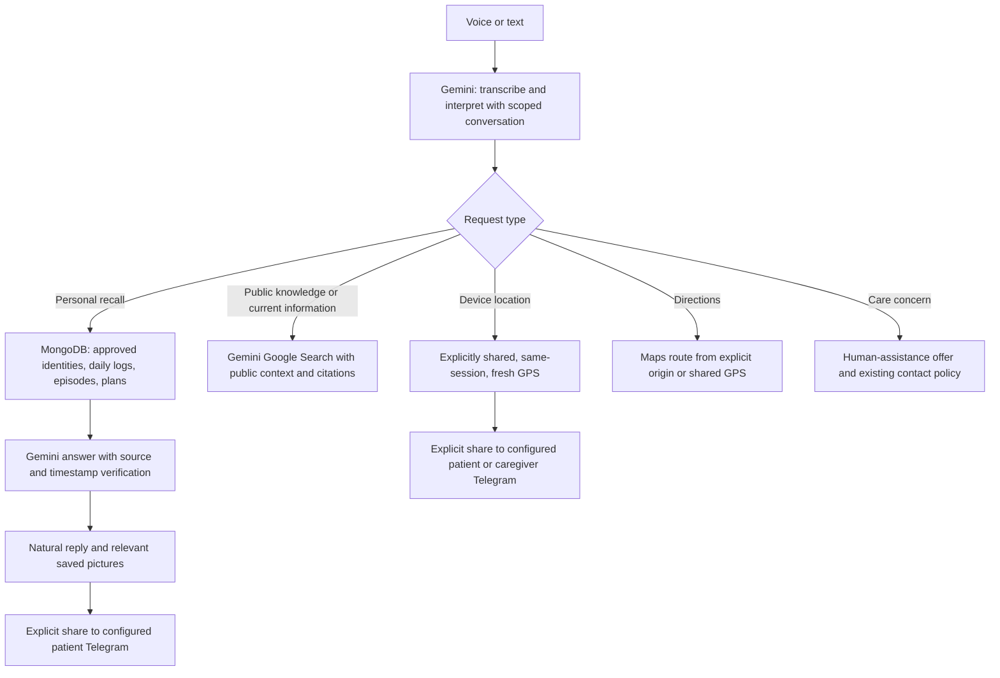

# Muse local handover

Prepared 25 October 2026. This handover is for running and testing locally, then letting the receiving teammate choose hosting. No Render changes are required or performed for this handover.

## Run

1. Install Node.js 24 and open a terminal in this folder.
2. Run `npm ci`.
3. Create your private `.env` using the environment examples and your own credentials. Do not commit it or include it in a shared ZIP.
4. Set `STORE=mongodb`, the intended `MONGODB_DATABASE`, `HOUSEHOLD_ID`, `SUBJECT_IDS` and `ANCHORCARE_PATIENT_ID`. All ingestion/recall components must use the same database, household and subject. A common Atlas cluster alone does not establish this.
5. Configure Gemini and distinct companion/admin access keys. Set `DEMO_PATIENT_AUTOLOGIN=true` for loopback-only fictional testing; this does not bypass production authentication. Leave PUBLIC_PATIENT_DEMO unset/false for full local features.
6. Run `npm run dev`, then open http://127.0.0.1:3000/ on this computer.

The active backend is root `server.ts` plus `integration/engram.ts`. Do not start the separate legacy `backend/server.js` expecting it to be the same pipeline. Restart the root server after changing backend files or .env. Frontend hot reload alone does not reload the backend.

## Verify

- `npm test` runs mocked/unit/HTTP regressions, not actual Telegram sends.
- `npm run lint` checks TypeScript.
- `npm run build` checks the production frontend build.
- With the local server running, `npm run verify:local` checks real MongoDB recall, previous-day retrieval, cited Gemini web answers, Maps directions and Telegram consent/configuration. It uses Gemini quota. It does not send Telegram messages, request GPS or insert patient memories. It writes a redacted report to ignored `tmp/local-verification.json`. Fictional family/day fixtures must exist for those recall checks.

The answer card labels saved-memory versus internet answers. A public question must not receive a random personal memory, and missing personal facts must not be replaced by a web guess about the person.

## Manual device checks

1. Start conversation, allow microphone access, speak one short thought, then pause. The default speech-ending pause is 800 ms; slower and manual modes are available in preferences. Replies are polled every 250 ms.
2. Confirm Listening → Thinking → Muse speaking → Listening, and use **Your turn** to interrupt playback. Stop ends device capture and saves the report.
3. Ask **Who is my daughter?**, then **Show me her picture**.
4. Ask **Summary of previous day**, then **What about breakfast?** Confirm both refer to the same date.
5. Ask **Can you tell me what is photosynthesis?** or **What is the weather in London today?** Confirm the answer includes internet sources.
6. Press **Share my current location with Muse**, allow browser permission and check the capture time/accuracy. Use a town/public landmark for web searches. Precise coordinates are not passed to web search. GPS may be inaccurate indoors; the app reports a device position, not proof a person is still there.
7. Set up Telegram with `docs/TELEGRAM-PICTURES-AND-LOCATION.md`. Only then use the explicit picture/location sharing buttons. Verify the actual phone receipt, not merely API acceptance.

Microphone, camera and GPS require device/browser permission and a secure browser context. Localhost on this computer supports local testing; a phone's 127.0.0.1 points to the phone itself. The phone must use the eventual reachable HTTPS deployment or receive Telegram messages. The server cannot silently turn on phone GPS.

## Routing

## Deployment responsibilities for the receiving teammate

Use a Node runtime compatible with the persistent reminder/session workers and in-process answer jobs, or redesign those pieces for the selected platform. Supply private environment settings on the host, the correct Atlas network access and a reachable HTTPS origin. Configure PUBLIC_APP_ORIGIN consistently. Keep credentials out of client code and Git. The included Dockerfile is available as a deployment starting point. Local .env changes do not configure any hosted service.

The ZIP does not include your private credentials, .git history, installed dependencies, captured media or database backups. Transfer required credentials separately and privately. Use fictional information for judging. Calls/Telegram acceptance must not be described as a confirmed answered call or confirmed assistance.
