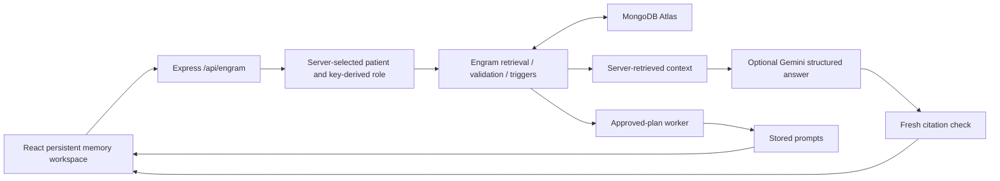

# Engram integration checkpoint

## Result

AnchorCare can now run the Engram memory/trigger module inside its existing Express process. The persistent memory workspace uses real server calls for ingestion, review, retrieval, optional Gemini generation and approved reminders. Existing browser demo screens remain separate and are labelled accordingly.

## Verification

- 8 original TypeScript engine tests passed, plus 1 new Express bridge integration test: **9 passed**.
- Imported Engram suite: **99 passed**.
- TypeScript check: passed.
- Production Vite build: passed under Node 24.22.1.
- Live HTTP-to-Atlas verification passed at **2026-10-24T01:28:46.157Z** (24 October 06:58:46.157 IST / 02:28:46.157 London). Fictional fixture: integration_1792805323669, in the server-selected synthetic patient/household.
- Verified draft exclusion, caregiver approval, retrieval and withdrawal through `/api/engram` routes. Atlas reported text search, vector search, native rank fusion and automated Voyage embeddings. Fixture retained as a draft after withdrawal.
- No live Gemini request made. The no-key path is labelled evidence_only. No Stream Processing deployment, external call or notification was made.

Dependencies required two compatibility fixes: Vite 8's esbuild peer dependency is now compatible, and the repository requires Node 22.12+. A lockfile is included. Installation/build on Windows was verified with Node 24 and optional native dependencies installed; run npm under the supported Node version.

## API mapping

All `/api/engram` calls use `X-AnchorCare-Key`. `/status` reports actual storage mode and server-selected patient. Client-supplied patient IDs and the original role switcher do not grant permissions. Caregiver key is required for episodes, review, plans/cancel, admin daily/person records and people. Companion key allows approved context reads, user reports, fresh context events and prompt responses.

Main routes mirror the component: /episodes, /episodes/review, /memory-context, /plans, /plans/cancel, /context-events, /prompts, /prompts/respond, /daily-logs, /personal-records and protected admin record routes. /answer builds evidence on the server and uses a context-aware JSON schema when a model key is configured.

The new UI's Save draft report stores the entered original note as evidence and as the searchable description; it does not claim automatic video extraction. Review is a separate caregiver action. Approve reminder is explicit approval of a fictional photo-album plan. The backend's normal quiet hours/cooldown remain enabled, so it may not deliver at night.

## Teammate setup

1. Pull the integration branch/PR and install with a supported Node version.
2. Configure the private root .env from .env.example; keep actual keys out of Git. Use the existing Engram database and queryable episodes_text/episodes_auto indexes, or provision them with the component scripts from its folder using the appropriate environment.
3. Set STORE=mongodb and the private URI, distinct service tokens, workspace access keys, subject allowlist and ANCHORCARE_PATIENT_ID. Example server patient is demo-person-001.
4. Run npm run dev, open the persistent memory workspace, and enter the appropriate access key manually.
5. Run `npx tsx integration/verify-live.ts` against the running server to repeat HTTP/Atlas checks. Uses fictional retained fixtures and does not call Gemini.
6. Set GEMINI_API_KEY and GEMINI_MODEL for a live model test. SDK presence/configuration is not proof of account access. Use only authorized synthetic inputs during hackathon validation.

## Remaining integration work

- Original browser ledger/actions/conversations are not migrated or synchronized. In particular, localStorage histories must not be bulk-promoted into caregiver-approved memory.
- Existing Python viewer code is reference material, not an executed Python service. The running integration is Node/TypeScript plus Engram JavaScript.
- The original /api/gemini/reason endpoint still uses client-provided context and is not the new authenticated retrieval path. Replace it with the protected bridge when migrating the original companion view.
- Shared access keys and a single server-selected patient are sufficient for local synthetic testing only; production needs individual sessions, device/user binding, HTTPS and proper authorization.
- No MongoDB transaction-based correction/supersession workflow or medical policy verification was added. Existing TypeScript correction tests prove browser-state transitions only.
- Durable reminder scheduling, live Stream Processing, voice/hardware capture, urgent-care workflows and guardian communication are outside this merge.

Source component imported from 4thul-jk/Engram-Hackathon commit **22b37bb**. Original repository history is retained there; the imported docs contain its historical checkpoints. Integration changes belong to AnchorCare's codex/engram-integration branch.
