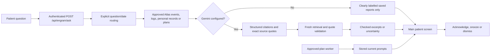

# Main companion integration

The architecture now connects both primary views to the same server-owned patient memory: Memory Ledger writes/reviews it, Patient Companion retrieves it. Original browser demos remain collapsed and separate; production user authentication and the main action screen migration remain incomplete.

## Changes

- AtlasCompanionView is now the main Patient Companion. It shares its in-memory access key with the main ledger and caregiver tools. Keys are never stored in localStorage. Users connect explicitly; the server derives patient and privileges rather than trusting the demo role switcher.
- New `/ask` route accepts question and discards browser-supplied evidence/actor data. A small deterministic router selects relevant collection categories. Existing `/answer` remains available for explicitly filtered caregiver requests.
- Past visits use episodic memory, identity/preferences use personal records, activity questions use daily logs, and future visits use plans. Today/yesterday/tomorrow and explicit ISO dates use configured timezone and DST-aware boundaries. Broader relative ranges request clarification rather than guessing today. This is a small router, not general natural-language understanding.
- Missing records and model outages are distinct. No-key operation displays source reports, not simulated Gemini answers. Zero retrieved records abstain before model invocation. Generated paraphrases remain withheld; only checked source excerpts are shown. Query relevance and factual truth still require assessment.
- Main companion polls deliverable prompt snapshots every three seconds and removes cancelled/expired prompts on refresh. A failed poll clears potentially stale cards and shows unavailable status. Responses use existing backend rules; Okay does not confirm activity completion. No push/audio notification transport is claimed.
- Component cancels outstanding question requests when credentials/view change and prevents obsolete responses replacing the current view. Network errors do not invoke browser sample logic.
- Disabled original unauthenticated client-context model endpoint with HTTP 410. The collapsed browser demonstration can still use its deterministic quotations, but does not perform that legacy model call.
- Reset browser samples is explicitly labelled: it does not delete Atlas data.

## Verification

27 root tests passed, including route selection, yesterday physiotherapy vs future visits, daily medication provenance, 25-hour DST day, input clarification, server-owned evidence, client failure and initial UI rendering. TypeScript check and production build passed. The existing 99-test memory component suite is unchanged from its prior passing checkpoint.

Live seeded-Atlas HTTP verification passed at **2026-10-24T06:32:12.652Z** (12:02:12.652 IST). `/ask` routed the exact physiotherapy/yesterday question to the previous-day episode, returning evidence_only as expected without a Gemini key. Seven other seeded-data checks passed. No live Gemini or new Stream Processing deployment claimed.

## Remaining steps

The main action ledger still needs server-side action proposals/approvals and outcome verification. Durable timer scheduling and pushed delivery are future improvements; the existing two-second backend worker and three-second prompt polling remain. Stream Processing setup is not completed. Shared prototype keys must be replaced by individual authenticated sessions before external deployment.

## 2026-10-24: natural Gemini answers

The main companion now uses Gemini claim text as natural patient-facing prose only after exact source citation checks and a second Gemini entailment check. Records are fetched again after verification to honour approval withdrawal during inference. If verification fails or is unavailable, display exact saved quotes. This is a probabilistic model check, not proof of truth. Generated answers remain untested live until a private Gemini key is configured.

Set GEMINI_API_KEY in the root private .env (never commit it), retain the event-required GEMINI_MODEL or select an available supported model, restart npm run dev and connect the companion. Ask about the seeded physiotherapy visit or Sarah. Responses should be short, calm and attribute reported facts. Missing records never establish that an activity did not happen. Each provider request has a 20-second timeout.

Read aloud/Stop speaking use the browser speech synthesis engine, not Gemini audio. Playback requires an explicit click; voice availability depends on the device. No microphone, continuous audio, or general multi-turn chat is implemented by this change. No conversation is stored at the Gemini provider (store:false).

Validation: 29 root tests and TypeScript passed, including verifier failure, non-boolean approval, and bounded natural text. The original exact-quote safety tests remain in place.

Live verification after private key configuration: POST /api/engram/ask with 'Who is Sarah?' returned HTTP 200, status answered, conversational true, answer 'Sarah Mercer is your daughter.', with source_quotes_and_model_entailment_check. Clarified typed source identifiers in the generation instruction after an initial withheld answer. TypeScript passed. Private key was not logged or committed.

Identity retrieval fix (2026-10-24): patient name / Who am I questions now route to personal_records. Added an approved fictional patient identity fact through the idempotent seed (7 personal records). Live /ask 'What is my name?' returned 'Your name is Alex Mercer, and you go by Alex.' with conversational=true and source/model checks. Five routing tests and TypeScript passed.

Latency improvement (2026-10-24): lost/confused self-statements use an authenticated deterministic response before retrieval/model calls, explicitly stating location is unknown and nobody has been contacted. Live 'I am lost' API measured 49ms. Normal questions use low thinking, 900 output tokens, 15s generation deadline and 6s verification deadline with source-only fallback; database work is additional and not globally bounded. Removed one redundant retrieval; final approval recheck retained. Optional GEMINI_COMPANION_MODEL overrides the reasoning model for companion calls without changing ingestion. No claim of emergency contact or location tracking. Nine targeted tests, TypeScript and production build passed.

Lost conversation follow-up fix: server issues a random support-session token, bound to the authenticated patient/actor, held only in React memory and an ephemeral server map with ten-minute inactivity expiry. Location and landmark follow-ups bypass memory retrieval and Gemini. Reported locations are not verified GPS; no navigation, geocoding or caregiver notification occurs. Identity/memory questions leave this flow; 'end help' clears it. Tested misspelling 'gulidford', actor isolation, expiry and memory-question exit. TypeScript and nine targeted tests passed.

Visit relationship fix: plan queries also retrieve approved personal records so Gemini can join plan.personId to personId and cite the relationship plus scheduled timestamp. Explicit timezone/retrievedAt supplied to generation and timezone supplied to verification. Exact user question 'when is my daughtr coming' tested live: conversational answer identifies Sarah Mercer as daughter and scheduled visit today October 24 at 3 PM London time. Ten routing/support tests and TypeScript passed.

Atlas outage diagnosis: DNS and all three MongoDB TCP ports reachable, but MongoDB heartbeat fails with MongoNetworkError / ECONNRESET and no selectable primary. Both personal-record reads and reminders fail, independently of Gemini. Investigate current public IP against Atlas Network Access, cluster availability and network/VPN/firewall; do not bypass TLS or fabricate local memory answers. UI now labels credential acceptance separately from live data availability and explains the database outage.

Contact intent loop fix: support flow recognises contact/call caregiver independently of location responses. Repeated requests explain the call limitation and offer the phone Contacts or nearby staff assistance; yes/help and unable-to-use-phone follow-ups provide a short request-for-help script. No external call/message is sent or implied. Eleven targeted routing/support tests and TypeScript passed.

Gemini support and mobile hooks: see [MOBILE-INTEGRATION-HOOKS.md](MOBILE-INTEGRATION-HOOKS.md). Added checked natural help wording, six-turn support context, disconnected capability manifest and scoped idempotent integration-request audit records. Calling, messaging and GPS remain unimplemented. Live checked Gemini wording confirmed; 39 root tests passed.

Model requirement update: GEMINI_MODEL and GEMINI_COMPANION_MODEL both configured to gemini-4-argon. No Flash override remains active. Help time budgets adjusted to 15s generation plus 6s verification. Live POST /ask caregiver-contact question returned HTTP 200, responseSource gemini_checked, about 8.8 seconds. Four targeted model/hook tests and TypeScript passed. Calling/messaging/location capabilities remain disconnected.

Visitor query fix: visiting/visitors without past-tense markers routes to plans plus relationship records; today constrains the full Europe/London calendar day. Past visited/came/was questions remain episodic. Added present/past regression tests; twelve routing/support tests and TypeScript passed. Increased natural-answer verifier output allowance to avoid truncated JSON and exact-quote fallback.

## Gemini tool selection and microphone input

Gemini 4 Argon now receives a read-only retrieve_memory function declaration before Atlas retrieval. It selects sections, one calendar day and an optional daily activity. Server validation rejects extra arguments, arbitrary tools, unknown sections, invalid dates and dates outside one year; patient/household and result limits remain server-controlled. Plan retrieval automatically includes approved relationship records. The existing deterministic router is retained only as the no-key/error/invalid-call fallback. Tool selection adds one bounded model call (10 seconds), rather than pretending that database access happens inside the LLM. Results are passed to the existing source-cited answer generation and fresh approval checks. No external action tool is exposed.

Live test: "Who is dropping by to see me today?" returned X-Memory-Routing:gemini_tool_call, plans plus personal_records, HTTP 200, about 11.6 seconds. This run displayed source quotes because natural-wording verification did not pass; semantic verification of a controlled Sarah visit sentence passed separately. A fluent answer is not guaranteed when the model/checker disagree.

The patient screen adds Speak your question / Stop listening where SpeechRecognition or webkitSpeechRecognition exists. The browser asks microphone permission only after a click. Final recognised words fill the text field for review; they are not automatically submitted. Recognition ends after one utterance, stops on request and aborts on unmount. Permission and device failures retain typing. The browser may process audio through its vendor service. Read aloud remains browser synthesis, not Gemini audio. Physical microphone and browser permission behaviour need testing on the demo device; automated tests use a mock recognition engine.

Validation: 43 root tests, TypeScript and production build passed. Tool tests cover malicious arguments, invalid tools, date bounds, relationship retrieval and provider-failure fallback. Speech tests cover final transcript, denied permission, stop and suppression of late events after disposal. Integration-request hooks remain disconnected and do not call or message anyone.

Function calling reference: https://ai.google.dev/api/interactions-api

## Readable evidence fallback

Exact-source validation remains mandatory. Plan citations must now contain the complete stored timestamp rather than a substring. Patient-facing fallback formats that timestamp using the context timezone and joins a visitor name only through a cited relationship record with a matching personId and name present in its source quote. Plans remain explicitly scheduled intentions. Cancelled or unapproved plan states are rejected. Source citations remain available for review; the primary screen collapses supporting records after an answered query.

If Gemini generation times out, returns malformed JSON, or supplies unsupported claims for a visitor question, a narrowly scoped visit fallback freshly retrieves approved plans and personal records, filters by linked person/relationship for specific visitor requests, and passes canonical citations through the same source checks. It does not fill in missing patient names, confirm attendance or guess who visited. Generic non-visit questions retain uncertainty or source-only results. Exact quoted reports preserve medication uncertainty.

Live verification before the final visit fallback: Argon selected tools for the visit, name and medication questions. Name and medication returned source-based answers; the visit generation timed out. Unit regression covers the timeout fallback, unrelated visitor exclusion, cancelled plans, complete timestamps and London DST. Gemini output is preferred only when verification succeeds; deterministic presentation is labelled through verification metadata and conversational:false.

Final live visit check after fallback-routing fix: exact question 'Who is dropping by to see me today?' returned HTTP 200, gemini_tool_call, answered, source_quotes_and_model_entailment_check, natural answer 'Your daughter, Sarah Mercer, is scheduled to visit you today at 3:00 PM.' Provider-failure backup routing now recognises dropping/stopping by. Final targeted routing/source tests: 18 passed; TypeScript passed. Full suite at previous checkpoint: 47 passed, production build passed.

Medication reminder implementation and fictional simulation: see MEDICATION-DEMO.md. Added caregiver draft/approval, worker delivery, Taken/Not taken/Unsure/Snooze controls, transactional self-report logs and caregiver review. Six Atlas scenarios seeded; live approval-to-unsure-to-review test passed with retry deduplication. Validation: 51 app tests, 99 memory tests, TypeScript and production build. No real medication, dose, clinical confirmation, voice reminder or external contact implemented.

Lost-session interception fix: active support tokens no longer capture arbitrary follow-up text. Only explicit location reports, contact requests, inability-to-use-phone statements and help acknowledgements stay in the support flow. All other messages clear that session and reach Gemini memory tools. Contact intent is restricted to requests rather than past questions such as "When did I call my daughter?". Added regression for the screenshot sequence "I am lost" -> "is anyone visiting me today?", with API assertion that plans are retrieved instead of a support answer. Patient UI also provides Return to memory questions.

Broad conversation audit completed: see CONVERSATION-AUDIT.md. Added 26 regression tests and fixes for topic switches, title case, topic-specific confusion, medication wording and explicit date consistency. Validation: 78 app tests + 99 memory tests (177), TypeScript and build passed. Live lost-to-visit/name/medication transitions passed routing; medication answer remained evidence-only on timeout.

Gemini recovery implementation: see GEMINI-RECOVERY.md. Shared abortable retries now wrap all integrated companion inference stages. Added authenticated background reply jobs, progress/interim polling, cancellation and final evidence revalidation. No side-effect actions are retried. Validation: 86 app tests, 99 memory tests, TypeScript and build; live job accepted in 90ms and checked Argon answer in ~12.4s, separate cancellation verified. Jobs remain ephemeral with a 90s overall deadline.

Fast visits and automatic speech submission supersede the earlier review-before-send behaviour: see FAST-VOICE-DEMO.md. Clear visit queries show approved schedule fields without waiting for inference; Argon checks wording in background while the form is available. Exact screenshot query measured 341ms to first approved answer and 16.7s to Argon wording. Finished microphone utterances submit once automatically, with a cancel-recording option. Physical microphone operation still needs device testing.

Image recall added: see IMAGE-RECALL.md. Caregivers can upload, preview and approve person/memory pictures; bytes use MongoDB GridFS and metadata uses scoped memory_images. Companion retrieves approved images in parallel with text replies, then optionally resolves checked record references. Seeded clearly fictional Sarah and garden-walk illustrations. Live GridFS reads and name/relationship/caption selection passed; unknown David returned no picture. No face recognition, external URL fetching or automatic visual inference is claimed.
