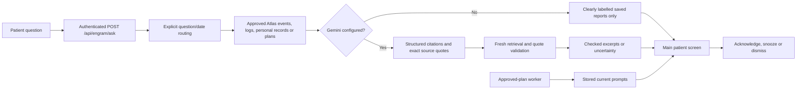

# Main companion integration

The architecture now connects both primary views to the same server-owned patient memory: Memory Ledger writes/reviews it, Patient Companion retrieves it. Original browser demos remain collapsed and separate; production user authentication and the main action screen migration remain incomplete.

## Changes

- AtlasCompanionView is now the main Patient Companion. It shares its in-memory access key with the main ledger and caregiver tools. Keys are never stored in localStorage. Users connect explicitly; the server derives patient and privileges rather than trusting the demo role switcher.
- New `/ask` route accepts question and discards browser-supplied evidence/actor data. A small deterministic router selects relevant collection categories. Existing `/answer` remains available for explicitly filtered caregiver requests.
- Past visits use episodic memory, identity/preferences use personal records, activity questions use daily logs, and future visits use plans. Today/yesterday/tomorrow and explicit ISO dates use configured timezone and DST-aware boundaries. Broader relative ranges request clarification rather than guessing today. This is a small router, not general natural-language understanding.
- Missing records and model outages are distinct. No-key operation displays source reports, not simulated Gemini answers. Zero retrieved records abstain before model invocation. Generated paraphrases remain withheld; only checked source excerpts are shown. Query relevance and factual truth still require assessment.
- Main companion polls deliverable prompt snapshots every three seconds and removes cancelled/expired prompts on refresh. A failed poll clears potentially stale cards and shows unavailable status. Responses use existing backend rules; Okay does not confirm activity completion. No push/audio notification transport is claimed.
- Component cancels outstanding question requests when credentials/view change and prevents obsolete responses replacing the current view. Network errors do not invoke browser sample logic.
- Disabled original unauthenticated client-context model endpoint with HTTP 410. The collapsed browser demonstration can still use its deterministic quotations, but does not perform that legacy model call.
- Reset browser samples is explicitly labelled: it does not delete Atlas data.

## Verification

27 root tests passed, including route selection, yesterday physiotherapy vs future visits, daily medication provenance, 25-hour DST day, input clarification, server-owned evidence, client failure and initial UI rendering. TypeScript check and production build passed. The existing 99-test memory component suite is unchanged from its prior passing checkpoint.

Live seeded-Atlas HTTP verification passed at **2026-10-24T06:32:12.652Z** (12:02:12.652 IST). `/ask` routed the exact physiotherapy/yesterday question to the previous-day episode, returning evidence_only as expected without a Gemini key. Seven other seeded-data checks passed. No live Gemini or new Stream Processing deployment claimed.

## Remaining steps

The main action ledger still needs server-side action proposals/approvals and outcome verification. Durable timer scheduling and pushed delivery are future improvements; the existing two-second backend worker and three-second prompt polling remain. Stream Processing setup is not completed. Shared prototype keys must be replaced by individual authenticated sessions before external deployment.
